# AIDLC Guide

AI-DLC の現在地・成果物・次の一手を、VS Code / Cursor の中で確認するローカル開発者ツールです。

**対応 aidlc-workflows バージョン: 2.11.1**（State Version **8** / **33** ステージ、`docs/official-docs.manifest.json` のピンと同期）。版の更新漏れは `bun run check` で検出します（[互換性チェック](docs/maintenance/release-and-sync.md#互換性チェックdocs-以外の追随)）。

> 名称は仮称です。要件は[PRD](docs/prd/PRD.md)、社内向けの紹介は[紹介資料](docs/introducing/README.md)を参照してください。

## 全体像

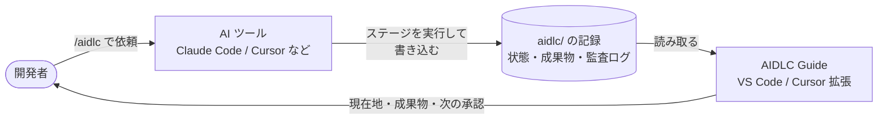

| 困りごと                         | AIDLC Guide での確認先                                                               |
| -------------------------------- | ------------------------------------------------------------------------------------ |
| 今どのステージにいるか分からない | [ステージ一覧](#ステージ一覧)                                                        |
| 成果物が多くて全体像が見えない   | 成果物マトリクスと[成果物ビューア](#成果物ビューア)                                  |
| 工程の時間や手戻りを比べたい     | [効果測定](#効果測定)と[時間の算出方法](docs/guides/stage-timing.md)                 |
| 調べ物で本線のセッションが濁る   | [ドキュメント](#ドキュメント)の質問欄と[MCP サーバー](docs/guides/side-questions.md) |
| 自分のブラウザで状態を見たい     | `bun run dashboard`（`127.0.0.1`）と[使い方ガイド](docs/guides/README.md)            |

## 画面の構成

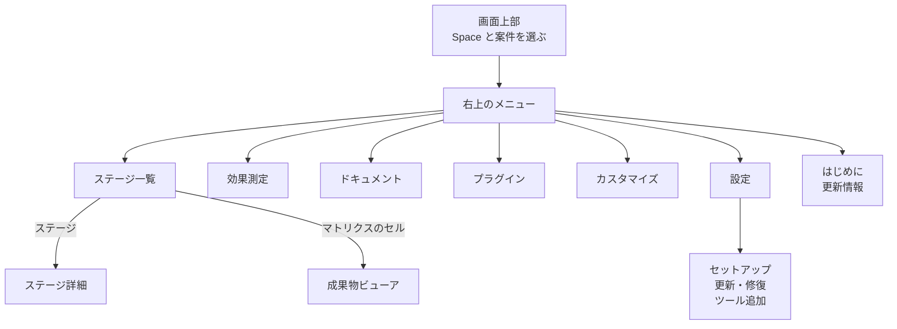

## 主な機能

画像は、ブラウザ版の Dashboard でこのリポジトリの開発記録（`260720-aidlc-guide-prd`）を表示して撮影し、説明用の番号を書き加えたものです（撮影日：2026-10-22）。数値はこの案件の記録で、導入効果の実績値ではありません。

### ステージ一覧

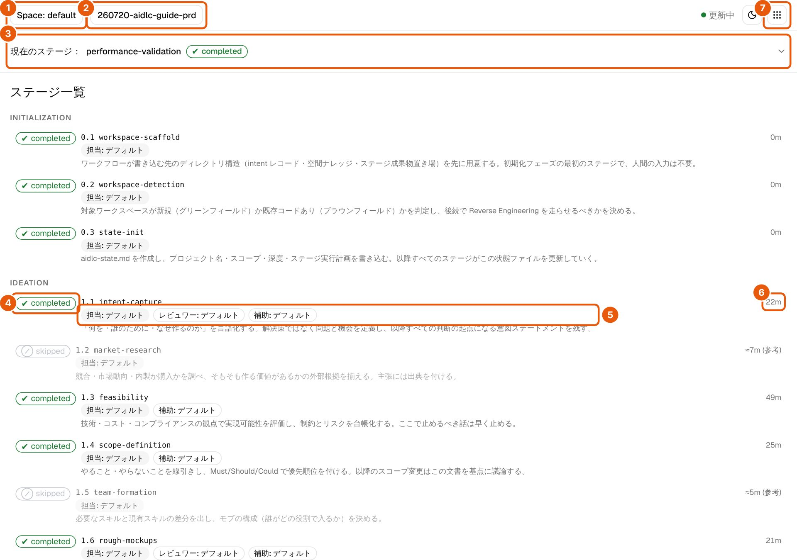

| 番号 | 見るところ                                                                                    |
| ---- | --------------------------------------------------------------------------------------------- |
| 1    | Space の切り替え。インテント・成果物・作業時間を読み直す                                      |
| 2    | 表示する案件（インテント）の選択                                                              |
| 3    | 現在のステージ。開くとフェーズ・スコープ・完了数・次の承認までの時間を表示                    |
| 4    | ステージの状態（completed・skipped など）                                                     |
| 5    | モデル。「担当」は Claude Code の使用記録から実モデル名を表示し、記録がなければ「デフォルト」 |
| 6    | 所要時間                                                                                      |
| 7    | 画面を切り替えるメニュー                                                                      |

モデル表示は再実行やレビューを含む使用記録の累計で、ここからモデルは変えられません。画面の下部には Unit × ステージの成果物マトリクスがあり、Construction では Unit ごとの進み具合も表示します。

### ステージ詳細

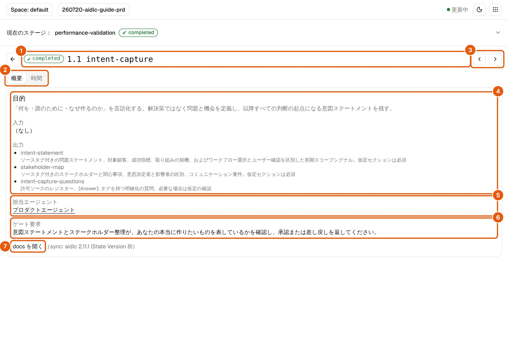

| 番号 | 見るところ                                                             |
| ---- | ---------------------------------------------------------------------- |
| 1    | 状態とステージ名                                                       |
| 2    | 「概要」と「時間」の切り替え。「時間」は作業時間・承認待ち・中断の内訳 |
| 3    | 前後のステージへの移動                                                 |
| 4    | 目的・入力・出力                                                       |
| 5    | 担当エージェント                                                       |
| 6    | ゲート要求（承認するときに確かめること）                               |
| 7    | 公式ドキュメントの該当箇所を開く                                       |

時間の計算方法は[ステージ時間の算出方法](docs/guides/stage-timing.md)を参照してください。

### 成果物ビューア

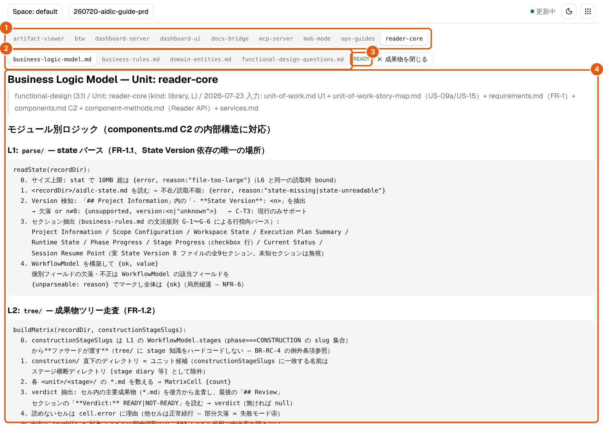

| 番号 | 見るところ                                                         |
| ---- | ------------------------------------------------------------------ |
| 1    | Unit の切り替え                                                    |
| 2    | ファイルの切り替え                                                 |
| 3    | レビューの判定（READY / NOT-READY）                                |
| 4    | 本文。Markdown を整形し、Mermaid と同じフォルダーの SVG の図も表示 |

成果物マトリクスのセルを選ぶと開きます。

### ドキュメント

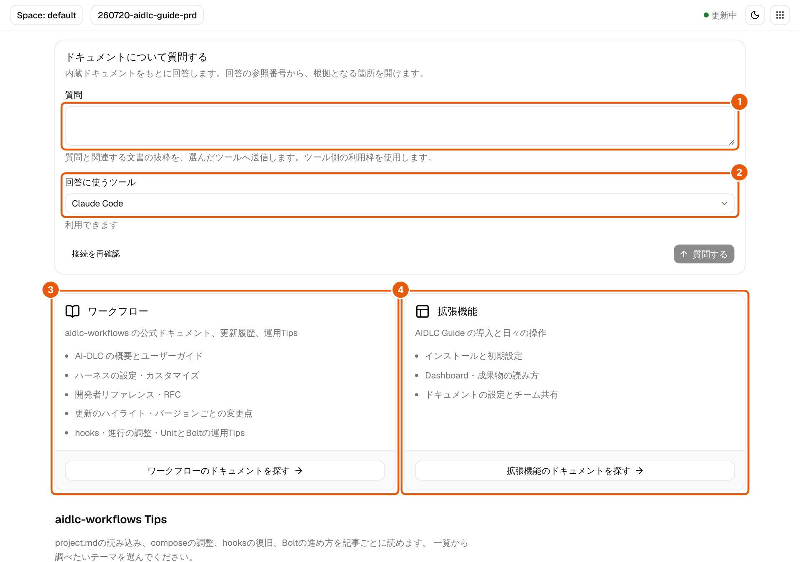

| 番号 | 見るところ                                                       |
| ---- | ---------------------------------------------------------------- |
| 1    | 質問欄。内蔵文書を根拠に回答し、続けて質問できる                 |
| 2    | 回答に使うツール（Claude Code / Cursor / GitHub Copilot の CLI） |
| 3    | ワークフロー：公式ドキュメント・更新履歴・運用 Tips              |
| 4    | 拡張機能：このリポジトリの[使い方ガイド](docs/guides/README.md)  |

回答の参照番号を押すと、根拠の箇所へ移動します。準備と使い方は[文書への質問ガイド](docs/guides/asking-aidlc.md)、更新履歴の要点は[更新のハイライト](docs/overview/ja/release-highlights.md)と[全バージョンの変更記録](docs/overview/en/changelog.md)を参照してください。

### 効果測定

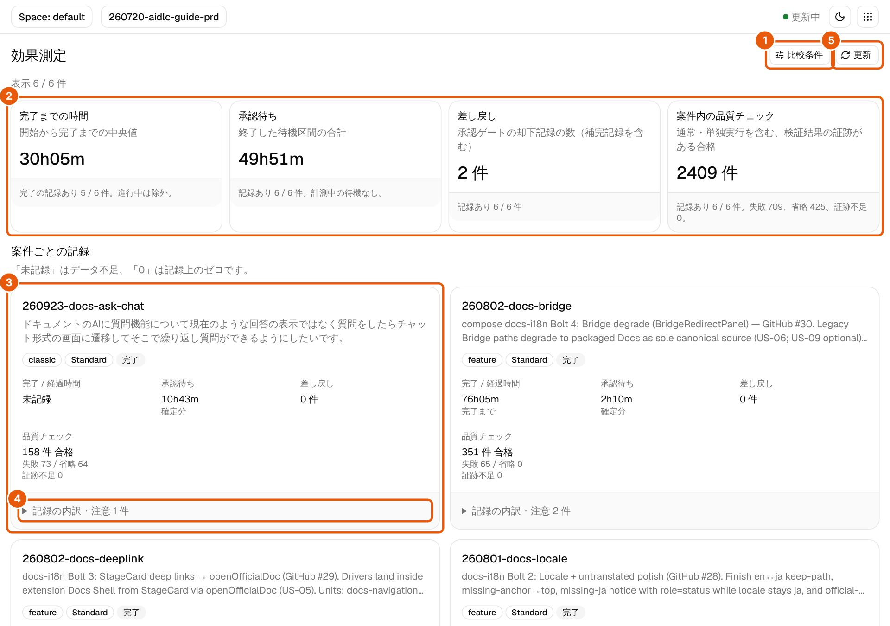

| 番号 | 見るところ                                                       |
| ---- | ---------------------------------------------------------------- |
| 1    | 比較条件（scope・depth で絞り込む）                              |
| 2    | 全案件の集計（完了までの時間・承認待ち・差し戻し・品質チェック） |
| 3    | 案件ごとの記録                                                   |
| 4    | 記録の内訳と注意点                                               |
| 5    | 記録の読み直し                                                   |

指標の読み方は[効果測定ガイド](docs/guides/effectiveness.md)を参照してください。

### カスタマイズ

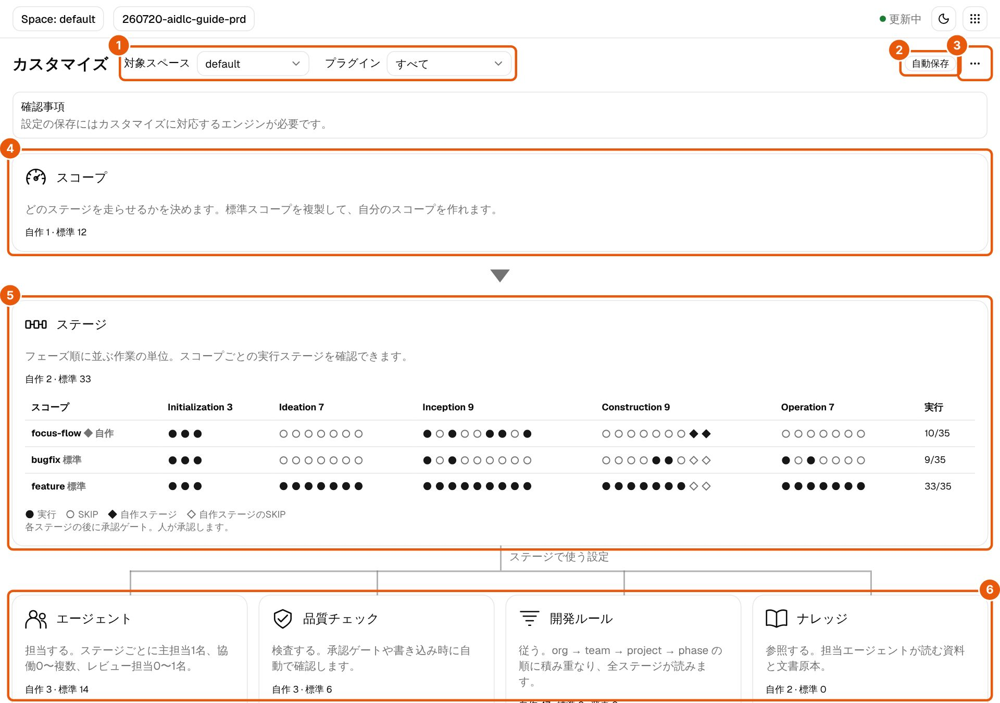

| 番号 | 見るところ                                                             |
| ---- | ---------------------------------------------------------------------- |
| 1    | 編集する Space とプラグインの選択                                      |
| 2    | 自動保存の状態。入力が止まると検証して保存する                         |
| 3    | 読み込み・書き出し・プラグイン管理                                     |
| 4    | スコープ（実行するステージの組み合わせ）                               |
| 5    | スコープごとの実行ステージ                                             |
| 6    | ステージで使う設定（エージェント・品質チェック・開発ルール・ナレッジ） |

保存には、カスタマイズに対応するエンジンと Bun が必要です。設定を共有する Space に未完了の作業がある間は保存できません。手順は[カスタマイズガイド](docs/guides/customization.md)を参照してください。

### プラグイン

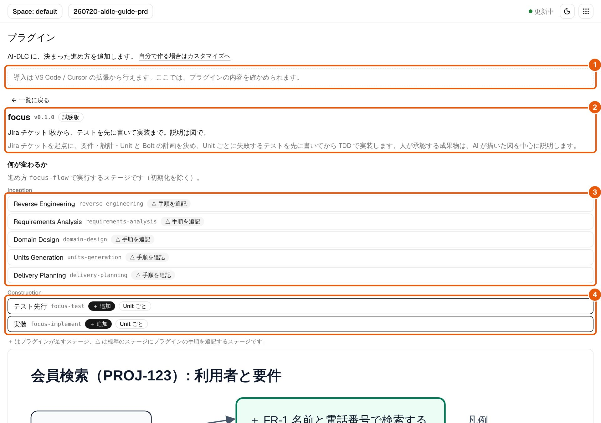

| 番号 | 見るところ                                                             |
| ---- | ---------------------------------------------------------------------- |
| 1    | 導入・無効化は VS Code / Cursor の拡張から行う（ブラウザ版は閲覧のみ） |
| 2    | プラグインの概要（同梱の focus は試験版）                              |
| 3    | 標準のステージに手順を追記するもの（△）                                |
| 4    | プラグインが追加するステージ（＋）                                     |

対象は、Claude Code（`.claude`）をネイティブの `aidlc` で導入したプロジェクトです。ファイルの変更は `aidlc` CLI が行い、未完了のワークフローがある間は操作できません。

### はじめに・更新情報・ヒント

| 表示     | 出るタイミング                                             |
| -------- | ---------------------------------------------------------- |
| はじめに | セットアップ後に初めて開いたとき。画面のツアーも始められる |
| 更新情報 | 拡張を更新したあとに1回                                    |
| ヒント   | ステージ詳細などを初めて開いたとき                         |

どれも右上のメニューから開き直せます。表示済みの記録はワークスペースに書き込みません（[はじめに・更新情報・ヒント](docs/guides/onboarding.md)）。

## はじめかた

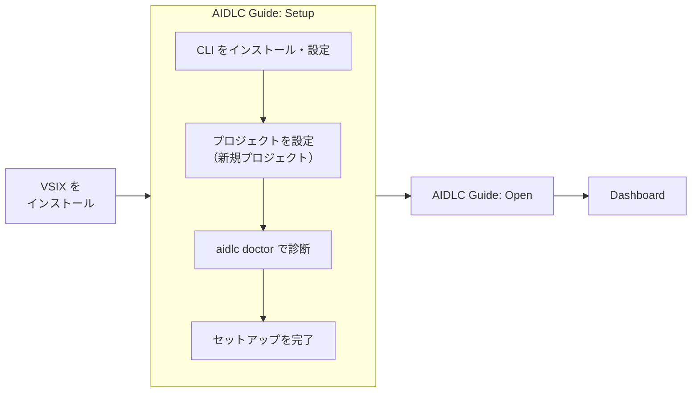

```bash
bun install
bun run build:extension     # dist/ + media/ のみ（F5 のデバッグ起動用）
bun run package:extension   # VSIX を作成（packages/vscode-extension/*.vsix）
code --install-extension packages/vscode-extension/aidlc-guide-*.vsix
```

Cursor では _Extensions: Install from VSIX_ からインストールします。自分でビルドしない場合は[Releases](https://github.com/otomatty/aidlc-guide/releases)の `.vsix` を使えます。日常の操作は `AIDLC Guide: Open` か、ステータスバーの `AIDLC Guide` です。各手順の詳細は[CLI とエンジンを導入・更新する](docs/guides/installing-and-updating.md)を参照してください。

## バージョンの確認と更新

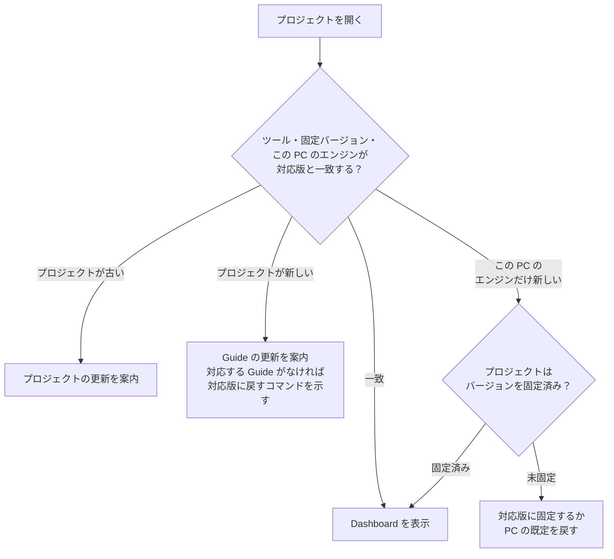

対応版と一致しない間は、同梱ドキュメントの閲覧・更新・Doctor だけを使えます。対応版は `WORKFLOWS_TARGET_VERSION` で指定し、上流の最新版へ自動では追従しません。プレビュー版は対応外として案内します（[バージョン確認の設計](docs/maintenance/version-gate-design.md)）。

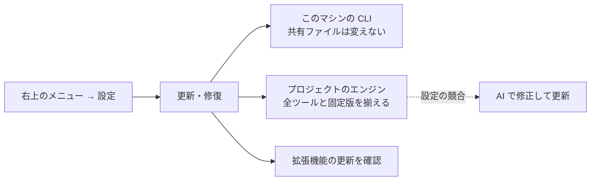

固定バージョンの扱い、失敗時の復元、同時に設定できないツールなどは[CLI とエンジンを導入・更新する](docs/guides/installing-and-updating.md)にまとめています。設定の競合は[更新時の問題を診断・修正する](docs/guides/updating-workflows.md)を参照してください。

## アーキテクチャ

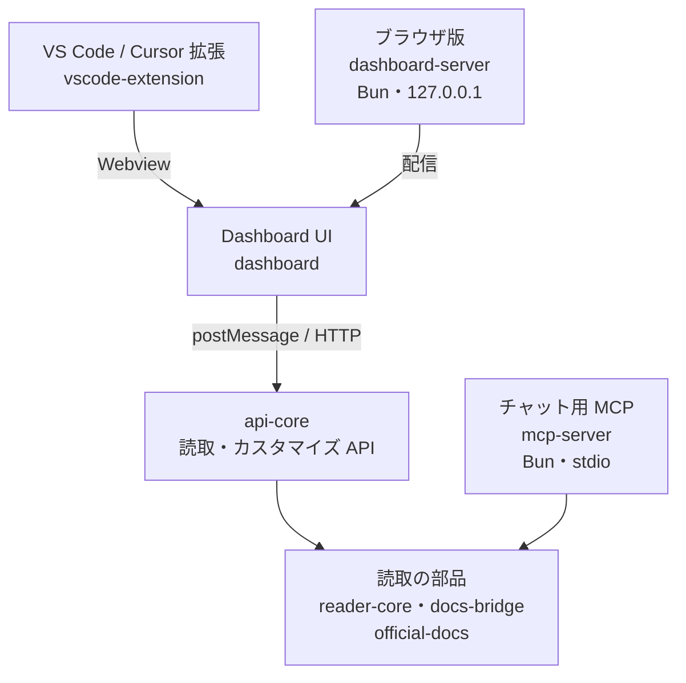

依存の向きと置き場の規約は[packages/README.md](packages/README.md)を参照してください。

## リファレンス

### 拡張コマンド

| コマンド                         | 用途                                                  |
| -------------------------------- | ----------------------------------------------------- |
| `AIDLC Guide: Open`              | IDE 内 Dashboard（セットアップ完了前はセットアップ）  |
| `AIDLC Guide: Setup`             | CLI の準備・プロジェクトの環境構築・診断              |
| `AIDLC Guide: Install Workflows` | ツール追加（AI-DLC を使うツールのインストール）       |
| `AIDLC Guide: Update Workflows`  | このマシンの CLI とプロジェクトのエンジンの更新・修復 |
| `AIDLC Guide: Check for Updates` | AIDLC Guide 拡張の更新を確認                          |
| `AIDLC Guide: Open Plugins`      | 「プラグイン」画面                                    |
| `AIDLC Guide: Show Welcome`      | 「はじめに」                                          |
| `AIDLC Guide: Show What's New`   | 「更新情報」                                          |
| `AIDLC Guide: Register MCP`      | Claude Code / Cursor の MCP と文書参照 Skill を登録   |

### パッケージ

| パッケージ（`packages/`） | 役割                                                            |
| ------------------------- | --------------------------------------------------------------- |
| `vscode-extension`        | VS Code / Cursor 拡張（第一サーフェス）                         |
| `dashboard`               | React UI（Webview とブラウザ版で共用）                          |
| `api-core`                | 読取・カスタマイズ API（HTTP / postMessage 共通）               |
| `dashboard-server`        | ブラウザ版 Dashboard のローカルサーバー（Bun、`127.0.0.1`）     |
| `mcp-server`              | Claude Code / Cursor 向けの読取専用 MCP                         |
| `reader-core`             | `aidlc-state.md`・成果物・監査の読取                            |
| `docs-bridge`             | ステージ slug・用語・エージェント → 公式 docs                   |
| `official-docs`           | 同梱した公式ドキュメントの読込・検索                            |
| `shared-types`            | 全サーフェス共通の型と定数                                      |
| `core-utils`              | パスの封じ込めなど、読取境界の共通処理                          |
| `kamishibai`              | 解説動画の描画エンジン                                          |
| `doc-video`               | 解説動画パックの作成ツール（メンテナ用。VSIX には含めない）     |
| `video-pack-ja`           | 日本語の解説動画パック（別の拡張として配布し、Docs 画面で再生） |

### 設定ファイル

ワークスペースルートの[`aidlc-guide.config.json`](aidlc-guide.config.json)で docs 連携を設定します。全ステージ分のキーを同梱しています。

| キー           | 用途                                                                                          |
| -------------- | --------------------------------------------------------------------------------------------- |
| `docsRepoPath` | 公式 docs のルート（excerpt 読取）。相対パスは config ファイル基準                            |
| `docsBaseUrl`  | （任意）ベース URL。`stageDocs` 未設定のステージで bridge-map の相対パスと結合                |
| `stageDocs`    | ステージ slug → 開き先 URL（Confluence / Notion / GitHub など `http(s)://…`）。空文字は未設定 |
| `projectLinks` | 右上のメニューの「プロジェクトリンク」に出す追加リンク `{ label, target }[]`                  |

「docs を開く」は `stageDocs[slug]` → `docsBaseUrl` + map パス → ワークスペース上のファイルの順に開き先を決めます。

### 前提

| 項目                  | 条件                                                                                              |
| --------------------- | ------------------------------------------------------------------------------------------------- |
| エディター            | VS Code 1.100 以上（拡張ホストの Node 20 が前提）。Cursor などのフォークも同じ下限                |
| 対象ワークスペース    | aidlc-workflows 2.11.1（State Version **8**）。ほかの版は[更新を案内](#バージョンの確認と更新)    |
| [Bun](https://bun.sh) | MCP、ブラウザ版の Dashboard、カスタマイズの保存などで使用                                         |
| AI ツール             | MCP は Claude Code か Cursor。ドキュメントへの質問は Claude Code / Cursor / GitHub Copilot の CLI |

## 開発

```bash
bun run test        # Vitest（素の `bun test` は dashboard を拾わない）
bun run lint        # oxlint（@shadcn/lint 含む）+ canonical クラス・パス + actionlint・CI 方針
bun run lint:fix    # oxlint の安全な自動修正
bun run format      # oxfmt の整形
bun run check       # 品質チェック全体
```

`bun run check` は、Lint・整形・型・文書索引・動画パック・プラグイン・互換性・テスト（カバレッジ付き）・監査ログ・依存の脆弱性を順に検査します。依存更新と main 保護は[依存更新と品質チェック](docs/maintenance/dependency-quality.md)を参照してください。

Claude Code で開発するときは、`AGENTS.md` を読み込む設定を各自で一度有効にします（[手順](AGENTS.md#claude-code-load-this-file)）。

## リリースと同期

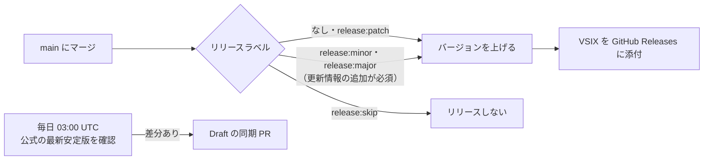

詳細は[リリースと upstream 同期](docs/maintenance/release-and-sync.md)を参照してください。

## 設計上の約束

| 約束                           | 内容                                                                                                     |
| ------------------------------ | -------------------------------------------------------------------------------------------------------- |
| 読取が基本                     | AI-DLC の記録は読むだけ。書き込みは利用者の明示的な操作に限る（下の表）                                  |
| aidlc-workflows 本体は触らない | 導入・更新・プラグインの反映は公式のインストーラーと CLI に任せる                                        |
| 独自のクラウドを持たない       | ブラウザ版も `127.0.0.1` だけで待ち受ける。外部への主な接続は GitHub Releases と、選んだ AI ツールの CLI |

| 書き込む操作               | 書き込む先                                                     |
| -------------------------- | -------------------------------------------------------------- |
| `[Answer]:` への回答       | `*-questions.md`                                               |
| セットアップ・更新         | 公式インストーラーと `aidlc config`（`.aidlc-version` を含む） |
| カスタマイズの保存         | ルール・資料・プラグインの定義                                 |
| プラグインの導入・無効化   | `aidlc` CLI 経由                                               |
| Space の切り替え           | 作業中の Space の記録                                          |
| MCP・文書参照 Skill の登録 | `.mcp.json` などの設定                                         |

## ドキュメント

| 文書                                                                         | 内容                                                                    |
| ---------------------------------------------------------------------------- | ----------------------------------------------------------------------- |
| [docs/guides/README.md](docs/guides/README.md)                               | **使い方ガイド一覧**（ユースケース別）                                  |
| [docs/prd/PRD.md](docs/prd/PRD.md)                                           | 要件・マイルストーン                                                    |
| [AGENTS.md](AGENTS.md)                                                       | Cursor / Claude Code での AI-DLC の進め方と、このリポジトリの開発ルール |
| [packages/README.md](packages/README.md)                                     | パッケージの依存の向きと置き場の規約                                    |
| [docs/maintenance/release-and-sync.md](docs/maintenance/release-and-sync.md) | リリース / upstream 同期の詳細（メンテナ向け）                          |
