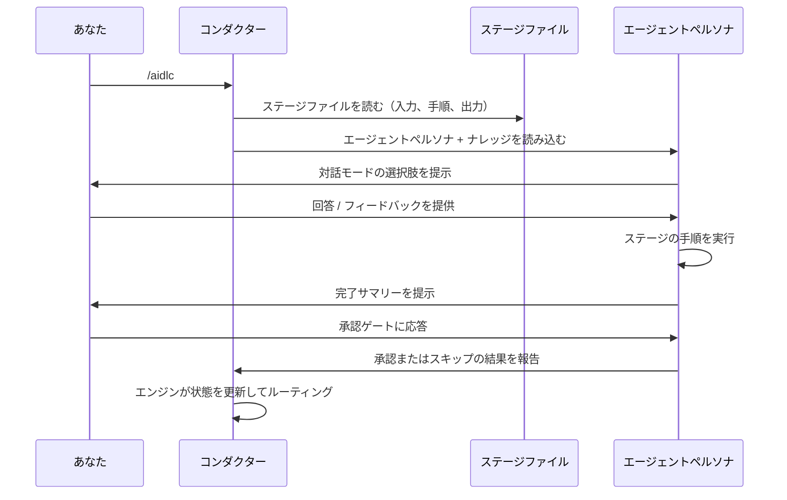
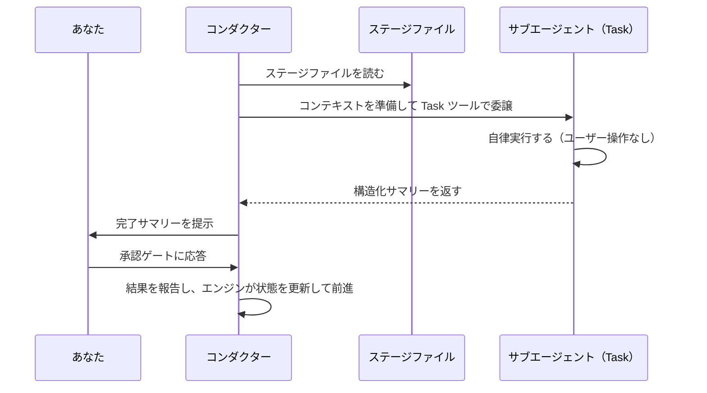

# 最初のワークフロー

この章では、AI-DLC の実行の各ステップで何が表示され、そこで何を決めるのかを説明します。
題材は [はじめに](01-getting-started.md#5-claude-code-での最初の実行) の実行、つまり在庫管理用の
REST API で、その画面は最初の承認まで同ページに載っています。実行全体を通しで追うのは
[実例](16-worked-examples.md) です。Classic、Express、Feature、その他の選択肢の比較は
[ワークフロープロファイル](workflow-profiles.md) を参照してください。

> **注記**: この章のトランスクリプトは **Claude Code** のものです。Kiro CLI、
> Kiro IDE、Codex CLI、opencode でもワークフロー（ステージ、エージェント、
> ゲート、成果物）は同一ですが、Claude 専用のウェルカムバナーは表示されず、
> AI-DLC のステータスラインは Claude Code と Codex でだけ、on にしたときに
> 表示されます。Kiro と opencode では
> `/aidlc --status` を、Codex では `$aidlc --status` と組み込みの
> `update_plan` 進捗表示を使ってください。すべての差異は
> [他のハーネスでの実行](harnesses/README.md) にある利用中ハーネスの章に
> まとまっています。

---

## ワークフローを開始する

```
/aidlc Build a REST API for inventory management
```

Claude Code がプロジェクトで起動すると、AI-DLC のウェルカムメッセージ、つまり
`.claude/settings.json` の `companyAnnouncements` エントリを表示します。AI-DLC の見出しの下に
「Run `/aidlc` to start or resume a workflow. Describe what to
build and AI-DLC proposes a plan for you to confirm.」と書かれ、続いてフェーズ、ステージ、
スコープ（出来合いの計画）と、それぞれが実行するステージが並びます。`companyAnnouncements` は
Claude Code の設定で、他のハーネスに同等のものはありません。他のハーネスではウェルカムは
表示されず、実行は以下の計画の質問から始まります。

### 既存ドキュメントから始める

既存のビジョン文書・PRD・要求概要について、置き場所の決まりはありません。テキストや Markdown をそのまま読ませる場合は、最初の依頼でファイル名を示します。たとえば `/aidlc Read ./vision.md and build what it describes` のようにします。相対パスはプロジェクトルートから解決されます。そのパスに何もない場合、ワークフローはその名前のプロジェクト内ファイルを探します。一致が 1 つならそれを読み、どのファイルを読んだかを伝えます（遅くともステージの承認を求める時点で）。複数あれば番号付きの選択肢を示し、見つからなければパスを尋ねます。探す対象はドキュメントファイル（Markdown、テキスト、PDF、Word など）だけで、`.docker` や `.aws` のような隠しフォルダと、入れ子になった別リポジトリの中は対象外です。git で無視されるファイル、シンボリックリンク、秘密情報らしいファイル（`.env`、`*.pem`、`*.key`、`id_*`、または名前に "secret"、"credential"、"password"、"token" を含むもの）は一覧に出さず、プロジェクトの外を読むこともありません。すべてのファイルを列挙できない場合は、どれも選ばずにパスを尋ねます。

ドキュメントの内容を依頼へ直接貼り付けることもできます。あなたの指示とドキュメントのデータをワークフローが区別できるよう、内容を `<document>` と `</document>` で囲んでください。指示はブロックの前でも後でも、その両方に書いてもかまいません。

```text
/aidlc Build the product described below.
<document>
...vision document content...
</document>
Keep the first release read-only.
```

区切られた内容は、指示ではなく信頼できないデータとして扱われます。最初の `<document>` から最後の `</document>` までがすべてドキュメントになるため、貼り付けたテキストの中に `</document>` があっても、それ以降が指示に変わることはありません。閉じマーカーのない `<document>` はメッセージの残り全体を、開きマーカーのない `</document>` はそれより前の全体をドキュメントとします。ワークフローは、メッセージをどう分けたかを 1 行で伝えます。複数行の入力は、行指向の状態ファイルの外側にある、コミット対象の `<record>/project-description.json` へ 1 個の JSON 文字列として保存されます。状態ファイルの `Project` フィールドは、ドキュメントの外にあるあなたの指示の、安全な 1 行プレビューのままです。そのため、ワークフローの項目に見える Markdown の行が、選択されたスコープやライフサイクル状態を変えてしまうことはありません。ドキュメントだけで外側に言葉がないメッセージは「Build what the pasted document describes.」として扱われ、続く計画の質問でそのことが示されます。

`/aidlc knowledge onboard <path>` で、いつでも自分でドキュメントを追加することもできます。
プロジェクト内のどこにあるファイルやフォルダでも指定できます。ナレッジフォルダの外にあるものは
中へコピーされ、その行がコピー先を伝えます。

PDF や Word のファイルも同じように使えます。たとえば `/aidlc Build what ./brief.pdf describes` のようにファイル名を示します。ワークフローはそのファイルを `aidlc/spaces/<space>/knowledge/documents/` にコピーして[ナレッジベース](08-knowledge.md)に追加し、コピー先とドキュメント ID を 1 行で伝えたうえで（遅くともステージの承認を求める時点で）、テキストを読みます。あなたがコマンドを実行したり ID を入力したりする必要はなく、そのフォルダにすでにあるファイルを置き換えることもありません。ファイルが git で無視されている場合（または git が判断できない場合）は、コピーがコミットされることになるため、それでもコピーするかを先に尋ねます。テキストを読み取れない場合（その種類のファイルの抽出器がない、スキャンされた文書など）は、理由を伝えてテキストか Markdown の版を求めます。200,000 文字を超えるテキストは直接読まず、対応する形式のファイルを求めます。ドキュメントのパス・ファイル名・内容は、常に信頼できないデータとして扱われ、指示として扱われることはありません。

ビジョン文書に何を書くかは[ビジョン文書の書き方](writing-inputs/vision-document-guide.md)を、技術スタックとそのルールは[技術環境文書の書き方](writing-inputs/technical-environment-guide.md)を参照してください。技術スタックとそのルールは依頼ではなく、スペースのチームナレッジに置きます。

---

## 計画を選ぶ

エージェントはあなたの依頼を読み、計画、つまりこの種の作業向けの出来合いのステージの組を
提案します。質問には、計画の名前、ステージと承認ゲートの数、Construction で作業単位ごとに
繰り返すステージの数が示されます。在庫 API ではエージェントは `mvp`（19 ステージ）を
提案しました。`feature` の計画なら 33 すべてを実行します。次のことができます。

- 提案された計画で進める。
- 別の計画を使う。エージェントがほかの出来合いの計画をその長さとともに並べるので、
  1 つを選ぶか名前を入力する。
- この作業に合わせて計画をあつらえる。エージェントがあなたの言葉から独自のステージの組を
  提案する。

各計画の説明は [ワークフロープロファイル](workflow-profiles.md) に、後から深度やテスト戦略を
変える方法は [スコープ、深度、テスト戦略](05-scopes-and-depth.md) にあります。

---

## 初期化フェーズ (Initialization)（自動）

計画を選ぶと、3 つの初期化ステージが 1 秒をはるかに下回る時間で実行されます。あなたが
操作することはありません。それらはアクティブなスペースにこの作業の記録を作成し、準備を整えます。

### ステージ 0.1: ワークスペースの作成 (Workspace Scaffold)

フレームワークは記録を `aidlc/spaces/<space>/intents/<YYMMDD>-<label>/` に作成します（名前付きスペースを使わない限り `<space>` は `default` です）。作成されるのは、計画が実際に実行するフェーズごとに 1 つのフォルダだけなので、記録には存在するすべてのフェーズではなく計画が現れます。在庫 API の `mvp` の計画には Operation のステージがないため、その記録には `operation/` フォルダがありません（以下は最初のステージの後の最上位の一覧です）。

```text
aidlc/spaces/default/intents/261013-inventory-rest-api/
  aidlc-state.md
  audit/
  initialization/
  ideation/
  inception/
  construction/
  verification/
  project-description.json
```

`feature` の計画は 5 つのフェーズすべてを実行し、`bugfix` の計画はアイディエーションを飛ばしつつデプロイ関連のステージは残すため、`ideation/` は現れず `operation/` が現れます。チームナレッジ用の `aidlc/spaces/default/knowledge/` のようなスペースの共有フォルダも、同時に `intents/` の隣に作成されます。

ステージ単位のフォルダは事前には作られません。ステージのフォルダ（例:
`inception/requirements-analysis/`）は、そのステージが最初に成果物を書き込んだ
ときに現れます。記録に並ぶのは、常に何かを生み出した作業だけです。

### ステージ 0.2: ワークスペースの検出 (Workspace Detection)

決定論的なルールベースのスキャナーが、プロジェクトの最上位のファイルと、既知のソースディレクトリ（`src/`、`app/`、`lib/`、`pages/`、`components/`、`tests/`）の 6 階層までを調べます。ソースファイル、フレームワーク設定、パッケージマニフェストを見て、新規プロジェクト（greenfield）か既存プロジェクト（brownfield）かを分類します。最上位で手がかりが見つからない場合は、ほかのフォルダの中も 3 階層下まで調べるため、ソースが入れ物のフォルダ（例: `wordbook/`、`backend/`）の中にあるプロジェクトでも brownfield として検出されます。ハーネスのディレクトリや `aidlc/` など、AI-DLC 自身のファイルはあなたのコードとして数えないため、空のフォルダは greenfield のままです。

スキャンよりあなたの言葉が優先されます。`/aidlc --project-type brownfield "<what to build>"`（または `greenfield`）で始めてどちらかを示すか、いつでも普通の言葉で伝えてください（「これは既存のコードで、フロントエンドは ui-repo にある」など）。AI-DLC はフォルダをもう一度スキャンし、種別をあなたの指定として記録します。既存コードであれば Reverse Engineering を実行してから、元いたステージに戻ります。完了済みのステージは完了のままで、コードが分かる前に終わっていたステージは返答の中で名前が挙がるので、必要ならやり直せます。空のフォルダで新規プロジェクトとして始めた作業で、Construction より前にフォルダにコードが入った場合は、どちらなのかを一度だけ尋ねます。この選択はその作業にだけ有効で、次の作業ではフォルダをもう一度スキャンします。

### ステージ 0.3: 状態の初期化 (State Initialization)

オーケストレーターは、あなたが選んだ計画のステージ計画、その深度とテスト戦略、およびスキャナーの分類を持つ、インテントの `aidlc-state.md`（記録ディレクトリ配下）を書き込みます。空のフォルダではスキャンがコードを見つけないため、計画から Reverse Engineering が外れます。作業が既存のコードに対するものであれば、そう伝えれば AI-DLC がそれを実行します。

---

## アイデア創出フェーズ (Ideation)（対話型）

初期化の後、ワークフローはアイデア創出フェーズに入ります。ここから先の各ステージは対話的に実行され、承認ゲートを伴います。

### ステージ 1.1: 意図の取り込み (Intent Capture)(aidlc-product-agent)

Claude Code では、セットアップで AI-DLC のステータスラインを選んだ場合（または `/aidlc --statusline on` で on にした場合）、ターミナル下部のステータスラインが作業に追随します（Kiro と opencode では `/aidlc --status` を、Codex では `$aidlc --status` と組み込みの `update_plan` 進捗表示を使います）。在庫 API の実行では、1 ステージ後に次のように表示されました（バーのブロック文字と区切りの点はプレーンテキストで示し、右側のモデルの表示部分は省いています）。

```text
[AIDLC] inventory-rest-api - IDEATION [##--------] 1/4 > Feasibility -- Architect Agent
```

左から順に、作業（スペースが複数あるときは、スペースの名前が先頭に付きます）、現在のフェーズ、フェーズ進捗バーと比率（どちらもこのフェーズの完了したステージを数えます）、現在のステージ、それを主導するエージェントです。Construction では、バーの代わりに `Unit N of M` が表示されます。右側には、Claude Code のモデル、続いて `ctx:N%`（コンテキストウィンドウの使用量。Claude Code が報告するときに表示）、そして Claude Code が使用量を報告した後は、アクティブなワークフローと現在のセッションの入出力トークンとコストの見積りが表示されます。`AIDLC_DISABLE_USAGE_TRACKING=1` を設定すると使用量トラッキング（およびその表示部分）を無効化できます。

> このコストは公開料金から算出したローカルの見積りで、請求額ではありません。記録されたプロバイダーが Amazon Bedrock の場合、実際の請求額と一致しないことがあります。独自の料金で算出したり非表示にしたりする方法は[トラブルシューティング](15-troubleshooting.md#ステータスラインに出したくないコスト区間が出るまたは使用量追跡が気になる)を参照してください。

aidlc-product-agent は、ステージの質問を記録内のファイルに書き出し、どう答えたいかを尋ねます。**Guide me**、**I'll edit the file**、**Chat** のいずれかです（[画面](01-getting-started.md#5-claude-code-での最初の実行)）。

- **Guide me** はチャットで質問を数個ずつ尋ね、それぞれに選べる選択肢と自分の回答を入力する余地があります
- **I'll edit the file** では、示された質問ファイルに回答を書き込みます。終わったら伝えてください
- **Chat** は自由に議論し、エージェントが会話から意思決定を取り出します

各モードの詳細は [対話モード](07-interaction-modes.md) を参照してください。ステージの途中でモードを切り替えることもできます。選ぶのは一度だけです。後のステージは選んだモードを再利用してそのことを 1 行で伝え、変えたいときはそう伝えれば変わります。

すべての質問に答えると、エージェントはステージの文書を書く前に、回答を読み上げて一度確認を求めることがあります（要約確認。ほとんどの計画で on）。文書を書いた後、ステージは仮定しなければならなかったことを確定するよう求めることがあります。その後レビュアーのエージェントが主要な文書を検査し、承認の前の最後の質問は、このステージから次回のために覚えておく価値のあるものがあるかどうかです（学習の質問。ほとんどの計画で on）。

### 承認ゲート (Approval Gate)

続いて、ステージが生み出したもの、レビューで見つかったこと、承認の質問が表示されます。在庫 API の実行から、短くしたものを示します。

```text
Intent Capture & Framing is ready for your review. It produced intent-statement.md,
stakeholder-map.md and intent-capture-questions.md (8 questions, all answered), in
aidlc/spaces/default/intents/261013-inventory-rest-api/ideation/intent-capture/.

Stage: Intent Capture & Framing
Review outcome: Concerns remain for your decision.

| ID   | Severity | Where                                      | Status |
|------|----------|--------------------------------------------|--------|
| R-01 | Minor    | intent-statement.md > Initial Scope Signal | New    |
| R-02 | Minor    | intent-statement.md > Initiative Trigger   | New    |
| R-03 | Minor    | intent-statement.md > Success Metrics      | New    |

> R-03 Finding: The table carries a single, binary success metric ...
> R-03 Required action: Human should confirm at the gate that a single integration-adoption
  metric is sufficient, or ask a follow-up to add a data-accuracy or reliability metric ...

Decision options:
- Approve - continue with the open findings accepted.
- Request Changes - return to the listed artifacts so the required actions can be addressed.

 Approval
 Intent Capture & Framing complete. How would you like to proceed?
 > 1. Approve
   2. Request Changes
```

各指摘事項には、ID、重大度、場所、それを解決するものがあります。安定した指摘事項の一覧はエンジンが管理します。後の確認では変わった点だけが報告され、あなたの判断はしたとおりに保たれます。未解決の指摘事項をすべて受け入れたうえで先へ進むには **Approve**、列挙された成果物へ戻るには **Request Changes** を選びます。未解決の指摘事項を「該当しない」として却下する場合は、その ID と理由を伝えてください。レビュアーが修正済みとした指摘事項に同意できない場合は、その ID を挙げて修正されていない理由を説明し、変更を依頼します。エンジンは次の確認に向けてその指摘事項を再び開きます。通常の修正フィードバックでは、指摘事項の判断は何も変わりません。後方ジャンプの後、Keep と Modify ではこの一覧と判断が保たれ、Redo from scratch では `R-01` から新しい一覧が始まります。ワークフローの途中でアップグレードしても、それまでの判断は ID ごとに保たれます。修正プロセスの詳細は [対話モード](07-interaction-modes.md) を参照してください。

承認後には進捗行が表示されます。

```text
Progress: 1 of 19 stages done. Next: Feasibility & Constraints.
```

### 残りのアイデア創出ステージ

`feature` の実行では、ワークフローは Market Research、Feasibility & Constraints、Scope Definition、Team Formation、Rough Mockups、Approval & Handoff と続きます。小さな計画ではこれより少なくなります（在庫 API の `mvp` の計画は Intent Capture から Feasibility & Constraints へ進みました）。どれも同じパターンです。エージェントが作業し、あなたがレビューし、承認します。

一部のステージは **条件付き** で、スコープに応じてスキップされることがあります。ステージがスキップされる場合、オーケストレーターは理由を表示し、自動的に次へ進みます。

---

## インセプションフェーズ (Inception)

インセプションでは要件を具体化し、解決策を設計します。ステージ 2.1（Reverse Engineering）は既存コードベース（**brownfield**）のプロジェクトでのみ実行されるため、在庫 API の空のフォルダでは飛ばされました。このステージはあなたへの質問なしにバックグラウンドで動きます。コラボレーターがオフ（`enterprise` 以外のすべての計画の既定）なら、aidlc-developer-agent がコードをスキャンし、9 つのコードナレッジ文書を自分で書きます。コラボレーターがオンなら、開発者がスキャンし、その後 aidlc-architect-agent がそれらを書きます。どちらの場合も、結果はその承認ゲートでレビューします。

ほかのインセプションステージ（Requirements Analysis から Delivery Planning まで）は、Intent Capture と同じようにチャットであなたと一緒に進みます。Practices Discovery と User Stories は、コラボレーターがオンのときは支援エージェントも加えます（[サブエージェントへの委譲](#サブエージェントへの委譲-subagent-delegation) を参照）。

---

## コンストラクションフェーズ (Construction)

Unit分解とソースを生成するConstructionステージを含む新規のソロワークフローでは、既定は **unit-major・直列実行・検証済みUnitチェックポイント** です。1つのUnitが適用対象の設計ステージとCode Generationを終えてから、次のUnitが始まります。[Bolt](glossary.md) は引き続き2.9で計画するデリバリーのまとまりで、実行順は `bolt-plan.md` のグループではなく `unit-of-work-dependency.md` に従います。

Delivery Planningでは、コンダクターが `bun test`、`pytest`、`make check` などの実際のプロジェクト検証を提案し、そのコマンドを示して **Use this command to verify each completed Unit?** と **Approve** / **Request Changes** で尋ねます。インテントの `Construction Verification Command` を設定する前に、あなたの承認が記録されます。同じコマンドがすべてのUnit／バッチのチェックポイントで再利用され、変更するには改めて人間の承認の記録が必要です。グリーンフィールドのプロジェクトでまだ実行できる検証がなければ、選択を延期できます。その場合、最初のチェックポイントが検証を実行する前に尋ねます。コンダクターがコマンドをでっち上げたり、自動承認したりすることはありません。

skeleton-onでは、DAGの最初のUnitを最小の動作する統合スライスにします。そのUnitは、あなたのPlan Approvalと必要な要約確認を含めて、設計とコードを完成させます。続いて、記録済みで人間が許可したプロジェクト検証がスライスをエンドツーエンドで実証し、承認の質問に **Verified with `<verification_command>` (exit 0)** と表示されてから、あなたがスケルトンを承認し、後続のUnitが始まります。最初の設計ステージをレビューするだけでは、動作するスケルトンの実証になりません。

計画した作業をビルドから外すよう頼むと（「残りのストーリーは飛ばして」）、ビルドはそれなしで進み、その承認で何を外したかが示されます。例えば「Left out of this build: AC2.1.1, AC2.1.2 and AC2.2.1.」です。Unit の `traceability.json` は、外したそれぞれの項目をあなたの言葉とともに `Deferred` として保ちます。

自律方針の選択がまだ記録されていなければ、ワークフローは次に、残りの作業をどうビルドし続けるかを尋ねます。**Continue automatically** か **Review each checkpoint** です。

skeleton-offでは、代わりにConstruction開始時にこの選択が提示されます。回答は `Construction Autonomy Mode` として記録され、再開時にも尊重されます。後から明示的に依頼して変えることもできます。**Continue automatically** は定型の完了の質問を省きますが、Plan Approval、有効な要約確認、検証コマンドの選択、失敗にはあなたの対応が必要です。要約確認が適用されるのは `directive.ceremony.summary_confirmation === "on"` の場合だけです。**Review each checkpoint** は、Unitが完了するたびにあなたの承認を待ちます。

実行方式は別の選択です。unit-majorは直列のままです。stage-majorとswarm実行を明示的に選ぶと、対象となるCode GenerationのUnitを並列に実行でき、バッチチェックポイントは人間による確認にも自動にもできます。すでにチェックポイントで承認されたinline Unitは、後のswarmバッチで再構築されません。
そのバッチを準備する前に、inlineスケルトンのソースを含む承認済みのアプリケーションソースを明示的にコミットしてください。コンダクターが暗黙にコミットすることはありません。ツールは子を作る前にバッチ全体を検査し、ソースがまだ再現できない状態であれば、コミットして再試行する手順を示します。

チェックポイントの設定を持たない既存のワークフローは、旧来の最初のステージのレビューとステージゲートの動作を維持します。設計のみのワークフローとUnitのない流れは既存のステージ承認を維持し、チーム所有のUnitは独自のゲートのリズムを維持します。明示的に選んだ反復の選択は保たれます。適用対象のUnit作業がすべて終わった後、Build and TestとCI Pipelineがソリューション全体で1回実行されます。

---

## 運用フェーズ (Operation)

運用フェーズでは、解決策をデプロイし、監視し、改善します。7 つすべてのステージが条件付きであり、`mvp` や `poc` のような小さなスコープでは、このフェーズ全体がスキップされることもあります。

最後のステージ（4.7 Feedback & Optimization）の後、ワークフローは完了です。

---

## 実行モードの仕組み

ワークフロー全体を通して、2 つの実行モードに出会います。

### インライン実行 (Inline Execution)

大半のステージはインラインで実行されます。コンダクターはエージェントペルソナを読み込み、ステージの手順を会話の中で直接実行します。あなたはリアルタイムでエージェントとやり取りします。



<!-- Text fallback: あなたが /aidlc を実行します。コンダクターがステージファイルを読み、ナレッジとともにエージェントペルソナを読み込みます。エージェントが対話モードを提示し、あなたが入力し、エージェントが手順を実行して完了サマリーを提示します。あなたが承認ゲートに応答すると、コンダクターが結果をエンジンに伝え、状態が進みます。 -->

### サブエージェントへの委譲 (Subagent Delegation)

4 つのステージがバックグラウンドのサブエージェントへディスパッチされます。2.1 Reverse Engineering（パイプライン: 開発者によるスキャンの後、アーキテクトによる統合と書き出し）、2.2 Practices Discovery（サブエージェントのハブアンドスポーク: 主担当のドラフト、互いにブラインドな 3 つの支援レビュー、人間へのインタビュー、主担当による統合）、2.4 User Stories（モブ: 協働者が並行で貢献し、判断を要する意見の相違はステージ途中であなたに提示されることがあります）、3.5 Code Generation（サブエージェント）です。Practices Discovery は、スポークと最終統合の間で意図的にあなたを議論の場へ招き入れます。User Stories のモブも、ステージ途中で判断確認を提示することがあります。これらの支援エージェントが参加するのは、コラボレーターがオンのとき（`collaborators` 設定。出荷時にオンなのは `enterprise` だけで、`/aidlc --collaborators on` で 1 つの作業に対してオンにできます）です。コラボレーターがオフの場合、これらのステージはどれも主担当だけで実行されます。開発者がコードのスキャンとコードナレッジベースの書き出しの両方を行い、Practices Discovery は主担当のドラフトからそのままあなたへのインタビューに進み、User Stories にはモブのラウンドがありません。ワークスペース検出（0.2）はサブエージェントではなく、`aidlc-utility intent-create` の中で決定論的に実行されます。



<!-- Text fallback: コンダクターがステージファイルを読み、コンテキストを準備して Task ツール経由で委譲します。サブエージェントはユーザー操作なしで自律実行し、構造化サマリーを返します。コンダクターはそのサマリーをあなたに提示し、あなたが承認ゲートに応答すると、コンダクターが結果をエンジンに伝えて状態を進めます。 -->

---

## 生成される成果物

`feature` スコープのワークフローが終わると、インテントの記録ディレクトリ（`aidlc/spaces/<space>/intents/<YYMMDD>-<label>/`）には次が入ります。

```
aidlc/spaces/<space>/intents/<YYMMDD>-<label>/
  aidlc-state.md          # Where the work stands, stage by stage
  audit/                  # Full decision audit trail (per-clone shards, merged by timestamp)
  ideation/               # Intent, market research, scope, mockups
  inception/              # Requirements, stories, design, units
  construction/           # Per-unit code + test artifacts
  operation/              # Deployment, observability, incident plans
  verification/           # Phase boundary verification reports
```

（チームナレッジは 1 つ上のスペースレベル、すなわち `aidlc/spaces/<space>/knowledge/` に置かれます。これは `intents/` の隣にあり、そのスペースのすべてのインテントを通して蓄積されます。同様に、チームが承認したプラクティスと学習内容は `aidlc/spaces/<active-space>/memory/` にあるアクティブスペースのメモリ層に置かれ、インテントをまたいで持続します。）

---

## ステータスライン (Status Line)

Claude Code では、ワークフローの間、AI-DLC のステータスライン（on にしたとき。セットアップで尋ねられるか、`/aidlc --statusline on`）が現在位置を表示し続けます（Kiro と opencode では `/aidlc --status` と各ゲートでの進捗行を、Codex では `$aidlc --status` と組み込みの `update_plan` 進捗表示を使います）。在庫 API の実行から、バーと区切りの点をプレーンテキストで示し、モデルの表示部分を省いたものです。

```text
[AIDLC] inventory-rest-api - IDEATION [##--------] 1/4 > Feasibility -- Architect Agent
```

| 表示部分 | 意味 |
|---------|---------|
| `inventory-rest-api` | 作業。スペースが複数あるときは、スペースの名前が先頭に付く |
| `IDEATION` | 現在のフェーズ |
| `[##--------]` | フェーズ進捗バー（10 文字、比率と同じ数え方） |
| `1/4` | フェーズ内で完了したステージ。Construction では、バーと比率の代わりに `Unit N of M` が表示される |
| `> Feasibility` | 現在のステージ |
| `-- Architect Agent` | それを主導するエージェント |
| `ctx:N%` | コンテキストウィンドウの使用量（Claude Code が報告するときに表示） |
| トークンとコスト | アクティブなワークフローと現在のセッションの入出力トークンとコストの見積り（Claude Code のみ。Claude Code が使用量を報告した後に表示。`AIDLC_DISABLE_USAGE_TRACKING=1` で無効化）。コストは公開料金に基づく見積りで、請求額ではない |

作業が何も選ばれていない間は、`[AIDLC] ready` と表示されます。

---

## 次のステップ

- [スペースとインテント](03-spaces-and-intents.md) — ワークスペースが複数の実行をどう保持し、それらをどう開始・切り替えるか
- [フェーズとステージ](04-phases-and-stages.md) — 5 つのフェーズと 33 のステージの詳細な内訳
- [対話モード](07-interaction-modes.md) — Guide Me、Edit File、Chat の解説
- [セッション管理](11-session-management.md) — ステージ間の再開・やり直し・ジャンプ
- [用語集](glossary.md) — 用語リファレンス
