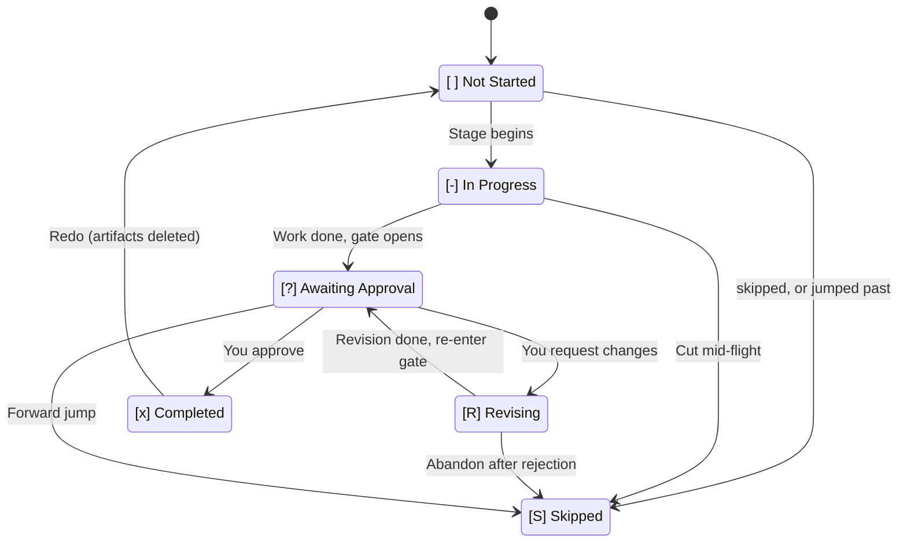
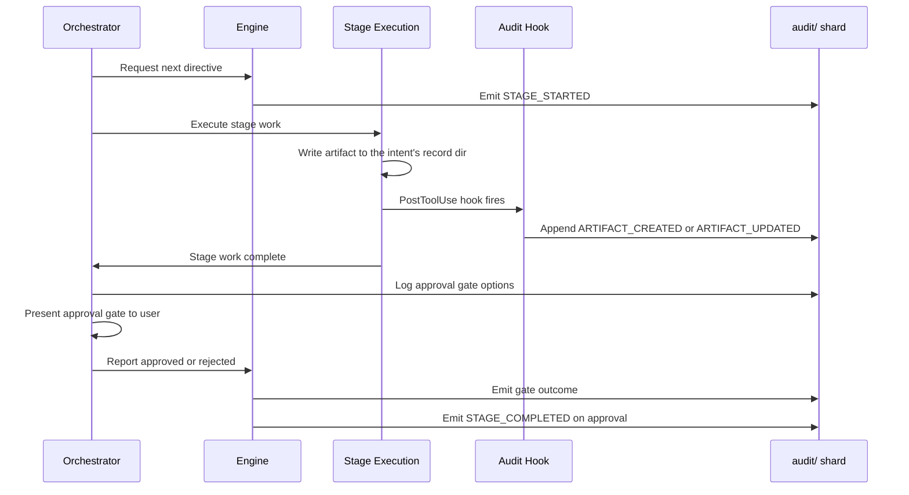

# 状態と監査

作業ごとにコミットされる記録を 2 つ持ち、インテントから本番まで辿れます。**状態ファイル**がワークフローの現在の位置、ファイルの入ったフォルダである**監査証跡**が途中の判断・動作・イベントです。

---

## 状態ファイル（`aidlc-state.md`）

インテントごとに、`aidlc/spaces/<space>/intents/<YYMMDD>-<label>/aidlc-state.md`（インテントのレコードディレクトリの下）に 1 本あります。そのインテントの進捗の正本です。エンジンはセッション開始のたびにアクティブインテントの状態ファイルを読み、終わったこと、進行中、次を決めます。

確定した説明文そのものは隣の `project-description.json` に、JSON 文字列 1 本で残します。`aidlc-state.md` はその確定ソースを指し、安全な 1 行の `Project` プレビューだけを持ちます。複数行の入力が状態フィールドを増やさないためです。2.6.115 より前の記録でソース印がないものは、従来どおり `Project` 欄を説明として使います。印のある新しい記録でファイルがない・壊れているときは、黙って劣化せずソース検証に失敗します。Git が sidecar 末尾の改行を正規化しても、JSON 復号は元の説明を保ちます。

### 中身

| 節 | 役割 |
|---------|---------|
| **Project Information** | プロジェクト説明、種別（greenfield / brownfield）とそれを決めた主体（`Project Type Source`: `workspace scan` または `you`）、スコープ、開始日、アクティブエージェント |
| **Scope Configuration** | 実行するステージ、スキップするステージ（理由付き）、深度、テスト戦略、`Review Override`、インテントごとの設定: `Guard Policy`、`Guards Off`（この作業で下げたフェンス）、`Guards On`（ポリシーの値より上に強制的にオンにしたフェンス）、`Sensors`、`Learnings`、`Summary Confirmation`、`Plan Approval`、`Collaborators`。フェンスの行は使ったときだけ現れ、作業ごとの切り替えがない human presence は含まない |
| **Workspace State** | プロジェクトルート、検出した言語、フレームワーク、ビルドシステム |
| **Execution Plan Summary** | ステージ総数、完了数、進行中のステージ |
| **Runtime State** | 改訂回数、Construction のチェックポイント、反復と実行方式の設定、受領記録に結び付いた Construction Verification Command、任意のユニット所有とユニットゲートのリズム |
| **Phase Progress** | 各フェーズを `Pending`、`Active`、`Verified`、`Skipped` のいずれかで示す |
| **Stage Progress** | ステージごとの完了チェックボックス |
| **Unit Progress** | Team モードのみ。導出されたユニットごとの Construction ステージとゲートセル。`next` が書き直す。正本ではない |
| **Current Status** | ライフサイクルフェーズ、現在 / 次のステージ、状態、最終更新時刻 |
| **Session Resume Point** | 最後に完了したステージ、次の動作、未処理の成果物 |

次は、`mvp` プランで Intent Capture が承認された直後の Claude Code 実行から取った一部です（短縮しています。ファイルでは各ステージとその `EXECUTE` または `SKIP` の間に長いダッシュが入りますが、ここでは `-` で示します）。

```text
## Scope Configuration
- **Depth**: Standard
- **Test Strategy**: Minimal
- **Review Override**:
- **Guard Policy**: off (from scope mvp)
- **Sensors**: on (from scope mvp)
- **Learnings**: on (from scope mvp)
- **Summary Confirmation**: on (from scope mvp)
- **Plan Approval**: on (from scope mvp)
- **Collaborators**: off (from scope mvp)

## Phase Progress
- **Initialization**: Verified
- **Ideation**: Active
- **Inception**: Pending
- **Construction**: Pending
- **Operation**: Skipped

## Stage Progress
### IDEATION PHASE
- [x] intent-capture - EXECUTE
- [ ] market-research - SKIP
- [-] feasibility - EXECUTE
- [ ] scope-definition - EXECUTE
...

## Current Status
- **Lifecycle Phase**: IDEATION
- **Current Stage**: feasibility
- **Next Stage**: scope-definition
- **Status**: Running
- **Last Updated**: 2026-10-13T10:43:59Z
```

`Guard Policy` と旧名の `Change Control` が両方あり、ポリシーの値が異なる場合、ステータスには次の `next` まで `strict (from conflicting state lines)` と表示されます。その `next` が一方を残し、唯一の行として書き込みます。残すのは、監査証跡上で最後に設定されたもの、それがなければあなたが設定したもの、それもなければスコープ自身のもの、それもなければより厳しいものです（`Source: command` と `Settled` フィールドを持つ `GUARD_POLICY_SET` 行がそれを記録します）。あなた自身の最後の選択を残した場合は何も言わず、それ以外の場合は一度だけ伝えます。たとえば次のとおりです。

> This work had two settings for how closely AI-DLC checks changes, and they disagreed. The record does not say which was set last, so AI-DLC keeps the stricter one: it checks everything. You can change it any time.

メモリが保持する strict は引き続き優先し、両方の行をそのまま残します。両方が一致していれば `Guard Policy` の行を使います。ポリシーの行を書き込むと旧名の行は除去され、設定は 1 つになります。

`Construction Verification Command` は、すべての Unit／バッチのチェックポイントで再利用するプロジェクトの検証を記録します。`state set-construction-verification-command` がこのフィールドを書く前に、現在のワークフローに合致する人間の承認の受領記録が必要です。フィールドだけで実行が許可されることはなく、汎用の `state set` はこれを拒否します。人間の **Approve** / **Request Changes** の回答は、尋ねたチャットでも、それが最新の質問である間は新しいチャットでも有効です。受領記録を許可するのは **Approve** だけで、無関係な回答、**Request Changes**、別の質問への回答は許可になりません。[記録済みコマンドの手順](12-cli-commands.md#construction-verification-command-record-human-authorization)を参照してください。

### 6 状態のチェックボックス

ステージ進捗は 6 状態のチェックボックスです。

| チェックボックス | 意味 |
|----------|---------|
| `[ ]` | 未着手 |
| `[-]` | 進行中 |
| `[?]` | 承認待ち（ゲート開放） |
| `[R]` | 改訂中（ゲートを差し戻し、ステージを直している） |
| `[x]` | 完了 |
| `[S]` | 作業の実行中にスキップ（`skip` で切った、`--stage` / `--phase` ジャンプで飛ばした） |

プランが含めないステージのボックスは変わりません。上の `market-research` のように、名前の後に `SKIP` が付いたまま `[ ]` に留まります。

順調なら `[ ]` → `[-]` → `[?]` → `[x]` です。ゲートで差し戻すと改訂中は `[R]`、準備ができたら `[?]` に戻り、承認で `[x]`。`/aidlc --status` はチェックボックスを読み、誰が止めているかを出します。`[?]` なら「Awaiting your approval on \<stage\>」、`[R]` なら「Revising \<stage\> (revision N of 3)」。

状態機械の正本（遷移表、監査イベントの発行元）は [Developer Reference: State Machine](../reference/12-state-machine.md) です。

### 状態遷移



<!-- Text fallback: [ ] 未着手はステージ開始で [-] 進行中へ。[-] 進行中は作業が終わりゲートが開くと [?] 承認待ちへ。[?] 承認待ちは承認で [x] 完了、差し戻しで [R] 改訂中へ。[R] 改訂中は直し終わりで [?] 承認待ちに戻る。[ ] 未着手、[-] 進行中、[?] 承認待ち、[R] 改訂中は、スキップ・ジャンプ・放棄で [S] スキップへ。[x] 完了はやり直し（成果物削除）で [ ] 未着手に戻る。 -->

### 通常・改訂・スキップ・やり直し・ジャンプ

- **通常:** `[ ]` -> `[-]` -> `[?]` -> `[x]`（ステージ開始、作業完了、ゲート開放、承認）
- **改訂:** `[?]` -> `[R]` -> `[?]` -> `[x]`（差し戻し、ステージ改訂、ゲート再開放、承認）
- **スコープスキップ:** なし。プランに含まれないステージは `[ ]` のまま、作業の作成時に `SKIP` と印
- **やり直し:** `[x]` または `[-]` -> `[ ]` -> `[-]`（やり直し要求。成果物を消し、ステージを再実行）
- **ジャンプ:** ステージ A が `[-]` のときステージ B へジャンプすると、間のステージは `[S]`

---

## 監査証跡（`audit/`）

監査証跡は、後のステージと復旧のために、アクティブなインテントの判断とイベントを記録します。書き込むのは AIDLC のツールとフックで、読み取りはどんな方法でもかまいません。書き込みのガードはガードレールであって、セキュリティ境界ではありません。書き込みを担うコマンドと読み取り専用の照会の契約は [Audit Trail Rules](../reference/04-stage-protocol.md#監査証跡の規則) を参照してください。

### 120 種のイベント分類

イベントは 25 カテゴリです。

| カテゴリ | 件数 | イベント |
|----------|------:|--------|
| **Workflow Lifecycle** | 7 | `WORKFLOW_STARTED`, `WORKFLOW_COMPLETED`, `WORKFLOW_PARKED`, `WORKFLOW_UNPARKED`, `WORKFLOW_ARCHIVED`, `WORKFLOW_UNARCHIVED`, `INTENT_REPOS_CHANGED` |
| **Phase Lifecycle** | 4 | `PHASE_STARTED`, `PHASE_COMPLETED`, `PHASE_VERIFIED`, `PHASE_SKIPPED` |
| **Stage Lifecycle** | 8 | `STAGE_STARTED`, `STAGE_AWAITING_APPROVAL`, `STAGE_REVISING`, `STAGE_COMPLETED`, `STAGE_SKIPPED`, `STAGE_JUMPED`, `STAGE_DEFINITION_CHANGED`, `SOURCE_WORK_NOT_FOUND`（Code Generation が探した場所に新しいコードが見つからなかったことと、そのときに取った行動: エージェントに伝えた、あなたに質問した、Guard Policy off のもとで身を引いた） |
| **Session** | 6 | `SESSION_STARTED`, `SESSION_RESUMED`, `SESSION_COMPACTED`, `SESSION_ENDED`, `HUMAN_TURN`（フック発行）、`HOST_TURN`（フック発行、助言: ホストがエージェント向けに作ったプロンプトで、人のターンではない） |
| **Initialization** | 3 | `WORKSPACE_SCAFFOLDED`, `WORKSPACE_SCANNED`, `WORKSPACE_INITIALISED` |
| **Navigation** | 9 | `SCOPE_CHANGED`, `SCOPE_DETECTED`, `DEPTH_CHANGED`, `TEST_STRATEGY_CHANGED`, `REVIEW_CLASS_CHANGED`, `RECOMPOSED`, `WORKSPACE_RECLASSIFIED`, `SCOPE_SAVED`, `PLUGIN_SELECTION_CHANGED` |
| **Guard Policy** | 5 | `GUARD_POLICY_SET`、`CHANGE_CONTROL_SET`（旧記録）、`CHANGE_ACCEPTED`、`GUARD_RESTORED`、`GUARD_STOOD_ASIDE` |
| **Ceremony** | 1 | `CEREMONY_SET`。`config-change` と `scope-change` の共通適用処理が記録する。`Key` は `sensors` / `learnings` / `summary_confirmation` / `plan_approval` / `collaborators`、`Old` は直前の保存値、`New` は新値、`Source` は `you` または `scope <name>`。旧値が不正なら原文、未保存ならスコープの既定値を使い、環境変数適用後の値とは区別する。保存値か設定元の実際の変更ごとに1行記録し、変更なしでは記録しない |
| **Interaction** | 17 | `DECISION_RECORDED`, `GATE_APPROVED`, `GATE_REJECTED`, `QUESTION_ANSWERED`, `QUESTION_REPLIED`, `QUESTION_UNANSWERED`, `REQUEST_ROUTED`, `SUMMARY_CONFIRMATION_RECORDED`, `VERIFICATION_COMMAND_RECORDED`, `CONSTRUCTION_POLICY_RECORDED`, `CHECKPOINT_VERIFICATION_RECORDED`, `PLAN_APPROVAL_RECORDED`, `PLAN_APPROVAL_SKIPPED`, `PLAN_APPROVAL_OVERRIDDEN`, `REVIEW_REQUESTED`, `REVIEW_COMPLETED`, `PIPELINE_LINK_COMPLETED` |
| **Unit Configuration and Lifecycle** | 9 | `UNIT_OWNERSHIP_SET`, `UNIT_GATE_RHYTHM_SET`, `CONSTRUCTION_POLICY_SET`, `UNIT_STARTED`, `UNIT_PAUSED`, `UNIT_RESUMED`, `UNIT_COMPLETED`, `UNIT_SKIPPED`, `UNIT_MERGED` |
| **Artifact** | 3 | `ARTIFACT_CREATED`, `ARTIFACT_UPDATED`（write-audit-log フック）、`ARTIFACT_REUSED` |
| **Subagent** | 3 | `SUBAGENT_COMPLETED`（log-subagent フック）、`SUBAGENT_PROMPT_UNMATCHED`（Copilot アダプタ、助言）、`REVIEW_VERDICT_DICTATED`（もう書かれない。以前のリリースの plan-approval-guard フック。レビュアー自身の `**Verdict Dictated:**` 行は現在 `REVIEW_COMPLETED` に載る） |
| **Reviewer Enforcement** | 2 | `REVIEWER_SCOPE_BLOCKED`（reviewer-scope フック）、`REVIEW_FREEZE_BLOCKED`（review-freeze フック） |
| **Plan Approval** | 2 | `PLAN_APPROVAL_BLOCKED`, `GUARD_DISABLED`（plan-approval-guard フック、またはこの作業でオフにしたフェンス） |
| **Documents** | 3 | `DOCUMENT_INDEXED`, `DOCUMENT_UPDATED`, `DOCUMENT_REMOVED` — インテント範囲でもスペース単位のシャード |
| **Utility** | 1 | `HEALTH_CHECKED` |
| **Error/Recovery** | 3 | `ERROR_LOGGED`, `RECOVERY_COMPLETED`, `COORDINATION_STOOD_ASIDE` |
| **Construction Bolt** | 4 | `BOLT_STARTED`, `BOLT_COMPLETED`, `BOLT_FAILED`, `AUTONOMY_MODE_SET` |
| **Worktree** | 7 | `WORKTREE_CREATED`, `WORKTREE_MERGED`, `WORKTREE_DISCARDED`, `STATE_FORKED`, `STATE_MERGED`, `AUDIT_FORKED`, `AUDIT_MERGED` |
| **Practices** | 4 | `PRACTICES_DISCOVERED`, `PRACTICES_AFFIRMED`, `PRACTICES_OVERRIDE`, `PRACTICES_SECTION_EMPTY` |
| **Merge Dispatch** | 3 | `MERGE_DISPATCH_INVOKED`, `MERGE_DISPATCH_RETURNED`, `MERGE_DISPATCH_FALLBACK` |
| **Sensors** | 5 | `SENSOR_FIRED`, `SENSOR_PASSED`, `SENSOR_FAILED`, `SENSOR_BUDGET_OVERRIDE`, `GUARDRAIL_LOADED` |
| **Learning Loop** | 3 | `MEMORY_EMPTY`, `RULE_LEARNED`, `SENSOR_PROPOSED` |
| **Swarm** | 7 | `SWARM_STARTED`, `SWARM_UNIT_CONVERGED`, `SWARM_SOURCE_MERGED`, `SWARM_UNIT_FAILED`, `SWARM_BATON_RETURNED`, `SWARM_COMPLETED`, `SWARM_DEGRADED` |
| **Commit Provenance** | 1 | `SOURCE_COMMITTED`。`aidlc attest anchor` または任意のセッション開始時走査が記録する補足情報。`resolve` は参照しない |

### 何をいつ記録するか

- **ステージの開始と完了**は毎回 `STAGE_STARTED` と `STAGE_COMPLETED`
- **エージェントがファイルツールで書く・編集するファイル**のうち、インテントのレコードディレクトリかスペースの `codekb/` にあるもの（`audit/` シャード自身を除く）は write-audit-log フックが残す。シェルコマンドで書いたファイルは残らない
- **承認ゲートの判断**（承認、差し戻し、このまま進める）は毎回
- **質問への回答**は毎回
- **サブエージェント完了**は log-subagent フックが残す
- **エラーと復旧**は毎回

### 監査ログの読み方

各シャードはプレーンな Markdown で、イベントごとに 1 ブロックです。上の実行の Intent Capture ステージから 2 つ示します。

```text
## Stage Start
**Timestamp**: 2026-10-13T10:27:19Z
**Event**: STAGE_STARTED
**Stage**: intent-capture
**Agent**: aidlc-product-agent

---

## Question Answered
**Timestamp**: 2026-10-13T10:34:07Z
**Event**: QUESTION_ANSWERED
**Stage**: intent-capture
**Details**: Q9: One total per SKU
**Person Reply**: One total per SKU
```

イベントの時系列は `aidlc engine audit history` で JSON として、1 つのステージだけを見るなら `--stage <slug>` を付けて確認します。各イベントは時刻、種類、名前付きのフィールドを持ちます。結果は古い順です。`unordered: true` は、書き手をまたいで順序が分からない同時刻のエントリを示します。自由形式のメモは、見出しと本文を持つ `NOTE` エントリとして表示されます。`--event NOTE` はメモを選び、`--stage` はメモを除外します。

以前の質問と回答の組は `aidlc engine log answers --stage <slug>`（Unit なら `--unit <unit>` を追加）で確認します。1 つの返答は、それが答えたメニューについて記録されたすべての質問と組になります。未解決の質問と、まれな曖昧な回答（前に質問がない、または書き手が同じ 1 秒で並んだもの）は別に報告されます。どちらのコマンドもファイルを変更せず、ロックも取りません。

### 監査イベントの流れ

ステージが実行され成果物を出すとき、監査証跡はその一連を残します。



<!-- Text fallback: オーケストレータが次のディレクティブを求め、エンジンが STAGE_STARTED を出す。ステージ実行が成果物を書き、PostToolUse フックが ARTIFACT_CREATED または ARTIFACT_UPDATED を追記する。作業と承認ゲートのあと、オーケストレータが結果を報告する。エンジンがゲート結果を出し、承認なら STAGE_COMPLETED を出して状態と経路を更新する。 -->

---

### ソースに紐づくレビューレシート

Code Generation はアプリケーションソースをインテントの記録の外に書くので、完了時のユニットごとのレビューレシートは Markdown 成果物だけでは足りません。対象ユニットの厳格な `source-manifest.json` が、作成・変更・削除したソースパスを列挙し、`Unit Source Fingerprint` がその主張とマニフェスト本体を束ねます。完了時、エンジンは新しいユニットから順に検証します（後からレビューした主張が、意図した共有ファイルの取り込みを所有できる）。そのうえで、新鮮な主張の和集合をステージ開始時のソースベースラインと比較します。Guard Policy が strict の場合、カバーされていない変更か、古いユニットがあると、完了経路は 4 つとも止まり、そのユニットに対する期限付きの stale-receipt 復旧が 1 回だけ出ます。Git が無視し、どのユニットも主張できないファイル（追跡されておらず `.aidlc-source-paths.json` にも登録されていないもの。ビルド出力やテスト実行の記録など）は、カバーされていない変更ではありません。そのファイルの `exclude` 一覧が走査から外すパスも同様で、その行がステージ開始後に書かれた場合でも変わりません（プロジェクトが無視していないツールのキャッシュや、このプロジェクトのコードではない入れ子のリポジトリなど）。登録ファイル自体は AI-DLC 自身のものなので、どのユニットも主張しません。strict の拒否は、通り抜ける 3 つの方法を示します。変更を行ったユニットがそのパスを列挙してもう一度レビューを受ける、誰も意図しなかった変更を元に戻す、ソースではないパスをそこで除外する、のいずれかです。relaxed または off の場合、カバーされていない変更は残されます。完了時に `CHANGE_ACCEPTED` として一度記録され、ファイルが 1 行で示されます（"These files changed outside any unit's work in Code Generation: ... Kept them."）。このマシンにステージ開始時のベースラインがない場合は、1 行の表示とともに確認を省きます。

ワークスペース全体の `Source Fingerprint` は、通常、レビュー後の変更の外側の境界です。文書化されている「revert」復旧を実際に効かせる狭い調停が 1 つあります。主張のないベースライン変更（追加・変更・削除）を完全に戻したあと、完了を続けられるのは次が揃ったときだけです。ステージのベースラインが存在して妥当であること、対象ユニットすべてに新鮮な現行バインディングがあること、ベースラインから現在までの差分に未主張のパスがないこと。レビュー後の通常の編集、古いかレガシーなユニット証跡、残っている未主張パスは、これまでどおり拒否します。アップグレード前のフィールド無しレシートやベースラインは、文書どおりマイグレーション時は fail-open を残します。現行の証跡が欠けているか壊れているときは fail-closed です。`AIDLC_SKIP_SOURCE_FRESHNESS=1` は決定論的な緊急オフスイッチで、bypass 印の付いたレシートを消費するときも、もう一度立てる必要があります。

レビュー後の AI-DLC の更新が変えるのは AI-DLC 自身のファイルだけなので、レシートの `Source Listing` がこのマシンにあれば、レビューは最新のまま保たれます。それを持たないレシートは、上と同じく `Source Fingerprint` で比較されます。

---

## 状態と監査の役割分担

状態ファイルと監査証跡は補い合います。

| 関心 | 状態ファイル | 監査証跡 |
|---------|-----------|-------------|
| **目的** | 現在の位置と進捗 | イベントの全履歴 |
| **読む側** | オーケストレータ（経路と再開） | 人と監査者（追跡） |
| **更新** | 状態が変わるたびに上書き | 追記専用（書き換えない） |
| **セッション再開** | 続き場所を決める正本 | 元のプロジェクト説明と判断の文脈 |
| **Git** | 版管理へコミット | コミットする（`audit/` 下のクローンごとのシャード。マージ衝突なし） |

オーケストレータは `aidlc-state.md` を永続カーソルに使います。チーム所有の Construction では、さらにユニットセル、レシート下限、ゲート、マージ行をアクティブインテントの監査シャードから導出します。ソロの経路は状態だけのカーソルのままです。監査証跡があれば、インテントから本番まで判断を辿れます。

状態ファイルが壊れたときは、`STAGE_STARTED` と `STAGE_COMPLETED` から組み立て直せます。直し方は [トラブルシュート](15-troubleshooting.md) です。

---

## 次に読む

- [セッション管理](11-session-management.md) — 再開に状態をどう使うか
- [成果物リファレンス](14-artifacts-reference.md) — インテントのレコードディレクトリに何が残るか
- [トラブルシュート](15-troubleshooting.md) — 状態壊れの修復
- [用語集](glossary.md) — 状態ファイル、監査証跡、チェックポイント、コンパクション
